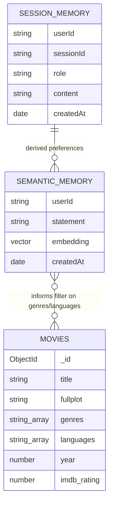

# Entity Document Diagram (EDD)

This document is the source of truth for the MongoDB data model used by **Personalised mflix**. Consult it before changing collection names, document structure, field names, queries, or any code that reads/writes persisted data.

The app uses two databases:

- **`MFLIX_DB_NAME`** (default `sample_mflix`) — read-only source of grounded movie data from the [Atlas sample dataset](https://www.mongodb.com/docs/atlas/sample-data/sample-mflix/).
- **`MEMORY_DB_NAME`** (default `personalised_mflix_memory`) — written exclusively by `@mongodb-developer/vercel-ai-memory`, which manages its own collections, TTL indexes, and Atlas Vector Search indexes.

## Entities

### movies (read-only) — `sample_mflix.movies`

The app reads a safe projection of these fields. Only fields actually consumed by the application are listed.

| Field | Type | Notes |
|---|---|---|
| `_id` | ObjectId | Primary key; serialized to string `id` in the API. |
| `title` | string | Required filter (`$exists`, `$type: string`). |
| `plot` | string | Short plot summary. |
| `fullplot` | string | Long plot summary; preferred over `plot` for cards. |
| `genres` | string[] | Used for genre filtering and genre rows. |
| `cast` | string[] | Top 4 shown on movie cards. |
| `directors` | string[] | Displayed on cards. |
| `countries` | string[] | Projected. |
| `languages` | string[] | Used for language filtering. |
| `year` | number | Used for year-range filters and sorting. |
| `runtime` | number | Displayed on cards. |
| `rated` | string | Content rating. |
| `poster` | string | Poster URL; filtered to exist for featured rows. |
| `imdb.rating` | number | Used for `minRating` filter and primary sort. |
| `imdb.votes` | number | Secondary sort key. |
| `imdb.id` | number | Projected. |
| `tomatoes.viewer.rating` | number | Shown as the Tomatoes rating. |

Queries used (see `lib/movies.ts`):
- `findMovies` — filter by genres/language/year/rating/avoid, sort by `imdb.rating`, `imdb.votes`, `year`.
- `searchMovies` — regex `$or` over title/plot/fullplot/genres/cast/directors.
- `getFeaturedMovies` — high-rated, recent, poster-bearing titles.
- `getGenreRows` — top titles per genre.

Suggested indexes (the sample dataset ships with `_id` only; add these for production-scale use):
- `{ genres: 1, "imdb.rating": -1 }`
- `{ "imdb.rating": -1, "imdb.votes": -1 }`
- `{ year: 1 }`

### Memory collections (managed) — `personalised_mflix_memory`

These collections are created and maintained by `@mongodb-developer/vercel-ai-memory`. Do not hand-edit their shape; configure behavior via the options in `lib/memory.ts`:

- **Session memory** — recent conversation turns. TTL: 7 days (`60 * 60 * 24 * 7`).
- **Semantic memory** — embedded durable preferences (genres, languages, directors, actors, eras, avoid list), embedded with VoyageAI (`voyage-3.5`), retrieved via Atlas Vector Search (cosine similarity, search limit 6).
- **Scratchpad** — short-lived working memory. TTL: 2 hours (`60 * 60 * 2`).

## Relationships

The application reads from `movies` and writes only to the memory database. There are no foreign keys; the connection between a user's remembered preferences and movie results is made at query time in `lib/recommendations.ts` and the chat tool loop in `app/api/chat/route.ts`.
