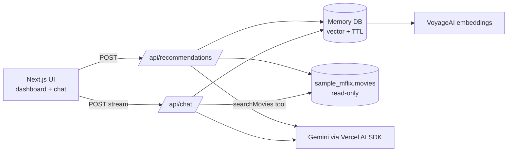

# Personalised mflix — AI movie recommender on MongoDB Atlas + Vercel AI SDK

[](https://github.com/mongodb-developer/personalised-mflix-ai-sdk/actions/workflows/ci.yml)
[](./LICENSE)

A Next.js 16 movie recommendation app that combines MongoDB Atlas `sample_mflix` data with the Vercel AI SDK and MongoDB-backed memory. It recommends movies, **remembers your stated preferences across sessions** using semantic memory and Atlas Vector Search, and grounds every answer in real movie data. Built for developers who want a working reference for agent memory with MongoDB.

## Features

- **Personalised recommendations** from MongoDB Atlas `sample_mflix.movies`, filtered by genre, language, year, and rating.
- **Persistent agent memory** via `@mongodb-developer/vercel-ai-memory` — durable preferences (liked genres, directors, actors, eras, content to avoid) are embedded and recalled across sessions.
- **Grounded chat** using a `ToolLoopAgent` with a `searchMovies` tool, so the model only recommends titles that exist in the dataset.
- **Atlas Vector Search** over VoyageAI embeddings for semantic memory retrieval.
- **TTL retention** for session (7 days) and scratchpad (2 hours) memory.
- **LeafyGreen-inspired** product UI.

## Tech stack

- **Framework:** Next.js 16 (App Router), React 19
- **Language:** TypeScript 5
- **Database:** MongoDB Atlas (`sample_mflix` + a memory database)
- **AI SDK:** Vercel AI SDK (`ai` v6) with the Google provider (Gemini)
- **Embeddings:** VoyageAI (`voyage-ai-provider`)
- **Memory:** `@mongodb-developer/vercel-ai-memory`

## Architecture overview

The dashboard and chat panel call two API routes. Recommendations and chat both read grounded movie data from `sample_mflix.movies` and persist/retrieve user preferences in a separate memory database backed by Atlas Vector Search.



See [EDD.md](./EDD.md) for the full MongoDB data model.

## Deploy your own

[](https://vercel.com/new/clone?repository-url=https%3A%2F%2Fgithub.com%2Fmongodb-developer%2Fpersonalised-mflix-ai-sdk&env=MONGODB_URI,GOOGLE_GENERATIVE_AI_API_KEY,VOYAGE_API_KEY&envDescription=Atlas%20connection%20string%20and%20AI%20provider%20API%20keys&envLink=https%3A%2F%2Fgithub.com%2Fmongodb-developer%2Fpersonalised-mflix-ai-sdk%23environment-variables)

The deploy flow only asks for the **three required secrets**. Everything else has sensible defaults baked into the code (see [Environment variables](#environment-variables)).

## Prerequisites

- **Node.js 20+**
- **MongoDB Atlas cluster** with the `sample_mflix` sample dataset loaded — see the [sample data guide](https://www.mongodb.com/docs/atlas/sample-data/sample-mflix/).
- **Google Generative AI API key** for Gemini.
- **VoyageAI API key** for embeddings.

## Quick start

```bash
git clone https://github.com/mongodb-developer/personalised-mflix-ai-sdk.git
cd personalised-mflix-ai-sdk
npm install
cp .env.example .env.local   # then fill in the three required secrets
npm run dev
```

Open <http://localhost:3000>. You should see the recommendation dashboard populated with movies, and a chat panel that remembers preferences you mention.

## Environment variables

| Variable | Required | Example / Default | Description |
|---|---|---|---|
| `MONGODB_URI` | ✅ | `mongodb+srv://...` | Atlas connection string (sample dataset loaded). |
| `GOOGLE_GENERATIVE_AI_API_KEY` | ✅ | `AI...` | Google Generative AI key for Gemini. |
| `VOYAGE_API_KEY` | ✅ | `pa-...` | VoyageAI key for embeddings. |
| `MFLIX_DB_NAME` | ❌ | `sample_mflix` | Database holding the `movies` collection. |
| `MEMORY_DB_NAME` | ❌ | `personalised_mflix_memory` | Database for session and semantic memory. |
| `GEMINI_MODEL` | ❌ | `gemini-3.1-flash` | Gemini model identifier. |
| `VOYAGE_EMBEDDING_MODEL` | ❌ | `voyage-3.5` | Voyage embedding model. |

The optional variables fall back to their defaults if left blank, so a minimal deploy only needs the three secrets.

## Project structure

- [`app/page.tsx`](./app/page.tsx) — LeafyGreen-style product dashboard.
- [`app/api/recommendations/route.ts`](./app/api/recommendations/route.ts) — preferences → memory → movie query → Gemini summary.
- [`app/api/chat/route.ts`](./app/api/chat/route.ts) — streaming chat using `ToolLoopAgent` with the `loadSession` / `onFinish` memory pattern.
- [`lib/memory.ts`](./lib/memory.ts) — configures `@mongodb-developer/vercel-ai-memory` (TTL + Atlas Vector Search).
- [`lib/movies.ts`](./lib/movies.ts) — MongoDB query helpers and safe projections.
- [`lib/recommendations.ts`](./lib/recommendations.ts) — orchestrates memory + movie queries + Gemini summary.
- [`components/`](./components) — React UI (dashboard, chat panel, movie cards).

## API overview

| Method | Path | Purpose |
|---|---|---|
| `POST` | `/api/recommendations` | Stores preferences as memory, retrieves related memory, queries `sample_mflix.movies`, and returns recommendations plus a Gemini summary. |
| `POST` | `/api/chat` | Streaming chat. Uses a `ToolLoopAgent` with a `searchMovies` tool and MongoDB-backed session/semantic memory. |

## Testing

There is no unit test suite. The smoke checks are:

```bash
npm run typecheck   # tsc --noEmit
npm run build       # production Next.js build
```

Both run in CI (`.github/workflows/ci.yml`) on Node 20.x and 22.x for every push and pull request.

## Database behavior and data safety

The application **reads** from the Atlas sample dataset and **writes only** to `MEMORY_DB_NAME`. The memory package creates TTL and Atlas Vector Search indexes for its own collections on first use. No movie data is modified. Vector Search indexes can take a few seconds to become queryable after initial creation.

## Troubleshooting

- **`MONGODB_URI is required` / empty dashboard** — ensure `.env.local` exists and `MONGODB_URI` points at a cluster with the `sample_mflix` dataset loaded.
- **No recommendations returned** — confirm the `sample_mflix` sample dataset is loaded (the `movies` collection must exist) and your Atlas IP access list allows your machine/Vercel.
- **Memory not recalled / vector errors on first run** — Atlas Vector Search indexes take a few seconds to build after the memory package creates them; retry after a short wait.
- **Gemini model not found** — if the model identifier changes in your Google account, set `GEMINI_MODEL` without changing code.
- **VoyageAI auth errors** — verify `VOYAGE_API_KEY` and that `VOYAGE_EMBEDDING_MODEL` is a model your key can access.

## MongoDB features demonstrated

- [Atlas sample dataset (`sample_mflix`)](https://www.mongodb.com/docs/atlas/sample-data/sample-mflix/)
- [Atlas Vector Search](https://www.mongodb.com/docs/atlas/atlas-vector-search/vector-search-overview/)
- [TTL indexes](https://www.mongodb.com/docs/manual/core/index-ttl/)
- [`@mongodb-developer/vercel-ai-memory`](https://www.npmjs.com/package/@mongodb-developer/vercel-ai-memory)

## Notes

- The UI intentionally follows MongoDB LeafyGreen product design: light surfaces, evergreen actions, serif display headings, quiet borders, and concise sentence-case copy.

## License

[MIT](./LICENSE)
